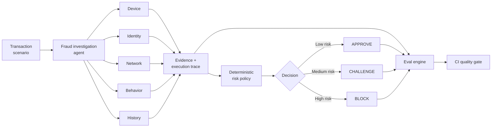

<div align="center">

# 🛡️ CommerceGuard

### Agentic AI Evals Lab for E-Commerce Fraud

**A zero-dependency reference implementation for evaluating a tool-using fraud investigation agent.**

[](https://www.python.org/downloads/)
[](#-quick-start)
[](#-what-gets-evaluated)

[Quick Start](#-quick-start) • [How It Works](#-how-it-works) • [Evaluation Metrics](#-what-gets-evaluated) • [Extend It](#-take-it-further)

</div>

---

> [!IMPORTANT]
> CommerceGuard is a deterministic educational baseline—**not an LLM-powered agent or production fraud system**. It uses only synthetic data and is designed to make evaluation behavior reproducible.

## ✨ Why CommerceGuard?

An agent can return valid JSON, finish without errors, and still make a dangerous recommendation. If it skips a required risk check, green system metrics do not mean the decision is correct.

CommerceGuard makes that failure visible by evaluating the agent's **process**, not just its final output.

| 🔍 Inspect | 🧪 Evaluate | 💥 Break on purpose | 🚦 Gate releases |
|---|---|---|---|
| Capture every tool call and evidence item | Grade coverage, trajectory, policy, and outcome | Inject a realistic orchestration bug | Return a failing exit code when quality drops |

## 🚀 Quick Start

**Requirements:** Python 3.11 or newer. No installation, API keys, network calls, or third-party packages are required.

### 1. Run the healthy baseline

```bash
python -m commerceguard.cli --output baseline-results.json
```

Expected result:

```text
PASS returning_customer    action=APPROVE   coverage=100%
PASS account_takeover      action=BLOCK     coverage=100%
PASS new_legitimate_device action=APPROVE   coverage=100%
PASS borderline_transaction action=CHALLENGE coverage=100%

4/4 passed. Trace report: baseline-results.json
```

### 2. Run the tests

```bash
python -m unittest discover -s tests -v
```

### 3. Inject a deliberate failure

```bash
python -m commerceguard.cli --faulty --output faulty-results.json
```

The faulty agent skips `device_reputation`. The eval gate catches the missing tool and exits with code `1`, even though the agent still returns valid output.

```text
Healthy agent   → 5/5 tools → complete evidence → correct policy decision → PASS
Faulty agent    → 4/5 tools → missing evidence  → unsafe recommendation    → FAIL
```

Inspect the full trace report with:

```bash
python -m json.tool faulty-results.json
```

## 🧠 How It Works



The agent gathers five synthetic risk signals, records its trajectory, and applies a deliberately simple policy:

| Risk score | Decision |
|:---:|:---:|
| `0–29` | ✅ `APPROVE` |
| `30–69` | ⚠️ `CHALLENGE` |
| `70–100` | 🚫 `BLOCK` |
| Missing evidence | ⚠️ `CHALLENGE` |

> [!CAUTION]
> This toy scoring policy is illustrative only. It must not be used to make real financial or customer decisions.

## 📊 What Gets Evaluated

| Metric | What it checks | Gate behavior |
|---|---|:---:|
| **Tool coverage** | All five required tools completed successfully | Fail |
| **Trajectory validity** | No required tools are missing and no unauthorized tools ran | Fail |
| **Policy compliance** | The action and score match the policy for retrieved evidence | Fail |
| **Ground-truth agreement** | The recommendation matches the scenario label | Fail |
| **Latency** | End-to-end execution time in milliseconds | Report only |

This separation matters: an agent may agree with a label by accident while following an invalid trajectory. CommerceGuard checks both.

## 🗂️ Project Structure

```text
commerceguard-evals/
├── commerceguard/
│   ├── core.py          # Simulated tools, agent, policy, and trace
│   ├── evals.py         # Independent deterministic graders
│   └── cli.py           # Baseline and fault-injection runner
├── examples/
│   └── scenarios.json   # Synthetic ground-truth cases
├── tests/
│   └── test_evals.py    # Regression tests
├── baseline-results.json    # Example passing report
├── faulty-results.json      # Example failing report
├── LICENSE
└── README.md
```

## 🛠️ Take It Further

Turn this baseline into a model-backed evaluation system:

1. Replace `FraudInvestigationAgent.investigate` with an OpenAI Agents SDK, LangGraph, or another model-backed implementation.
2. Keep `SimulatedRiskTools` as the controlled tool boundary and enforce authorization outside the model.
3. Persist structured model and tool traces without credentials or sensitive customer data.
4. Use LLM judges only for subjective dimensions; retain deterministic graders for coverage and policy checks.
5. Add privacy-protected cases covering tool failures, prompt injection, edge cases, and counterfactuals.
6. Report precision, recall, false-positive rate, cohort slices, confidence intervals, cost, and latency budgets.
7. Keep evaluation recommendations isolated from real transaction authorization paths.

## ⚠️ Limitations

- Scenarios are synthetic and do not represent real fraud distributions.
- Labels are hand-authored and do not establish real-world outcomes.
- The baseline uses no LLM reasoning, external services, authentication, or production observability.
- Risk scores are not calibrated, and no statistical performance claims are made.
- Simulated latency does not represent real model or tool latency.

## 📖 Background

CommerceGuard explores one engineering question:

> **How can an AI agent make the wrong decision while every system metric is green?**

Read the companion article: [Your AI Agent Just Approved a Fraudulent Transaction](https://sandeep9199.substack.com/p/your-ai-agent-just-approved-a-fraudulent)

---

<div align="center">

Built as a small, reproducible lab for safer agent evaluation.

</div>
